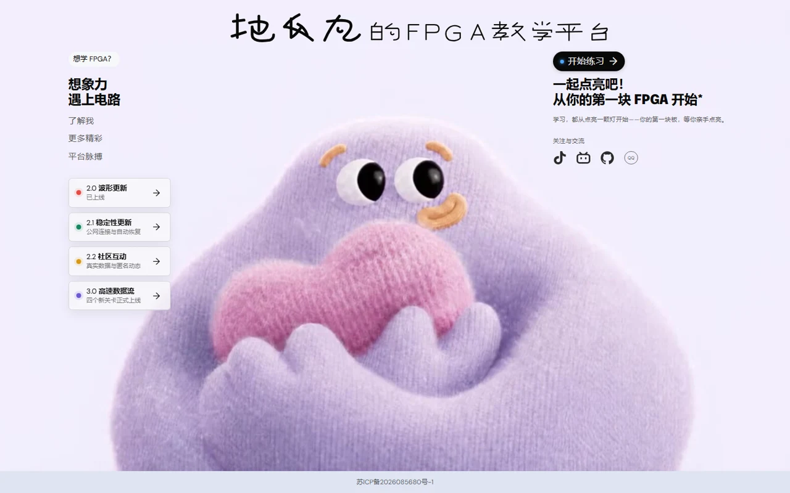
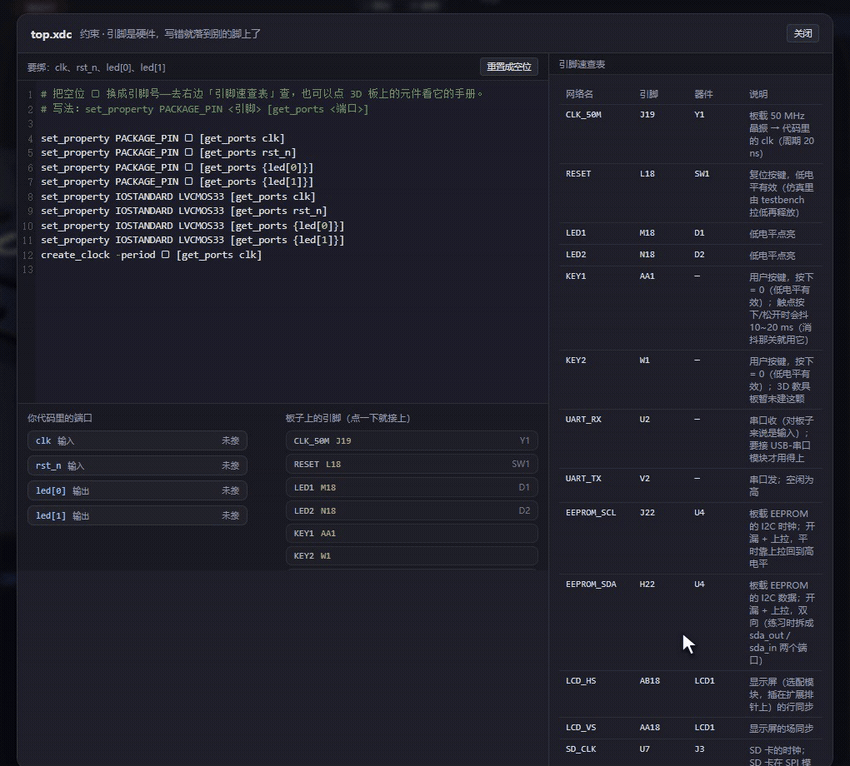
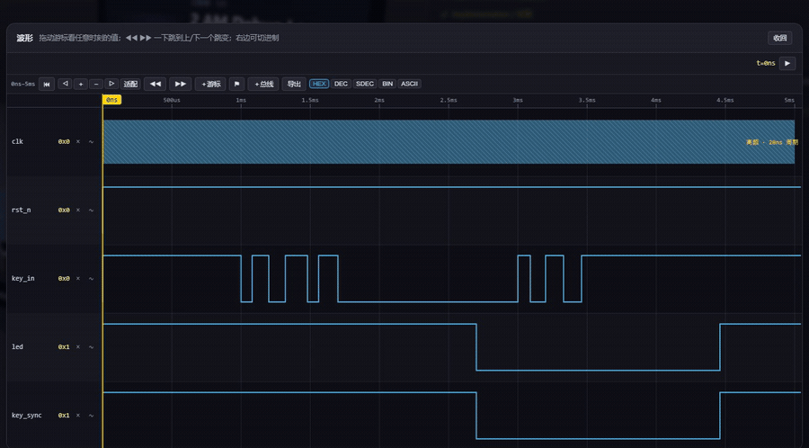
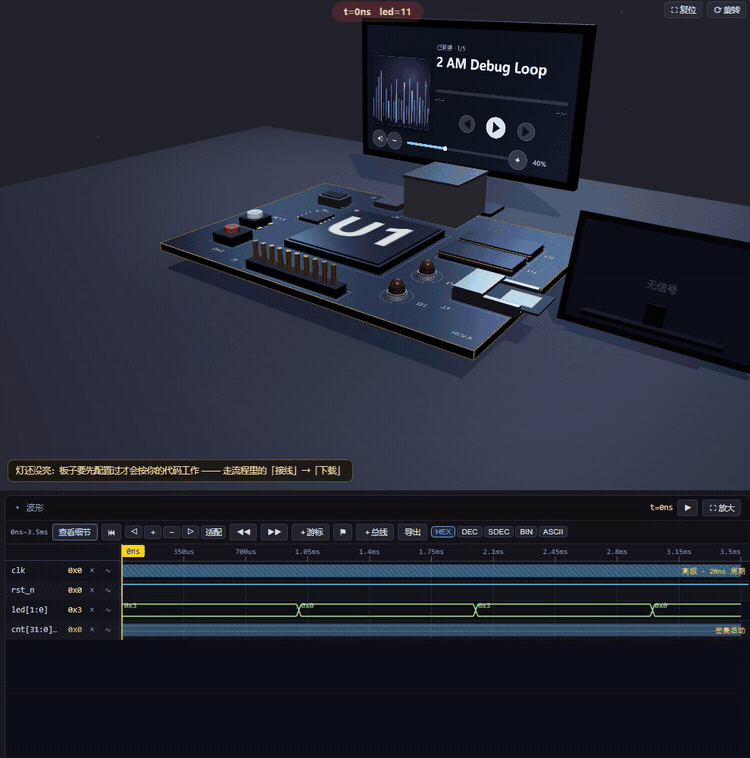
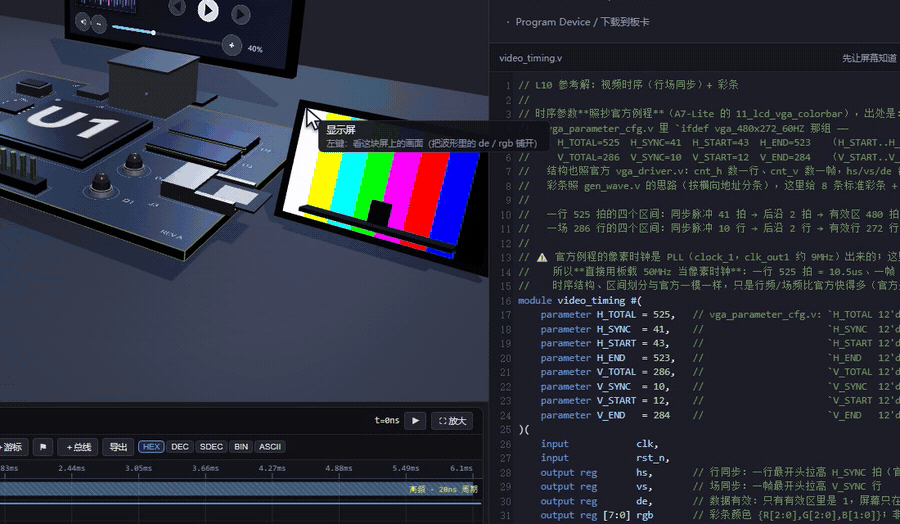
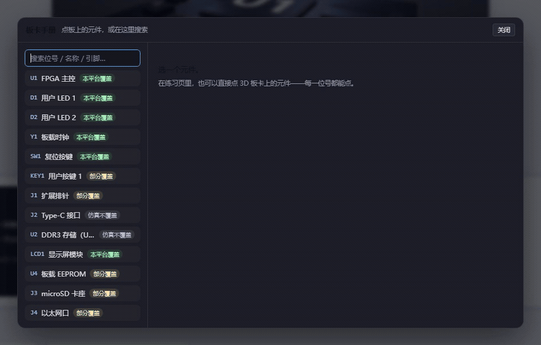
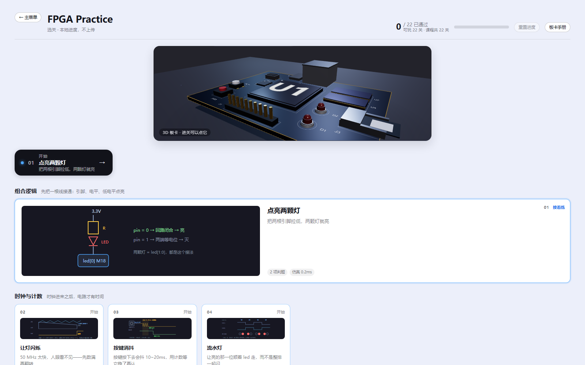
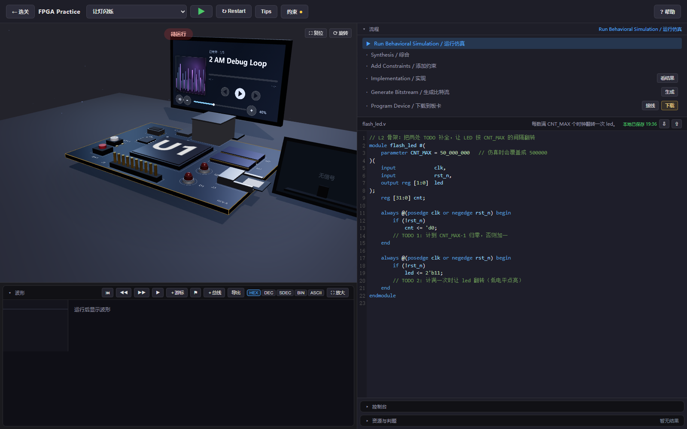
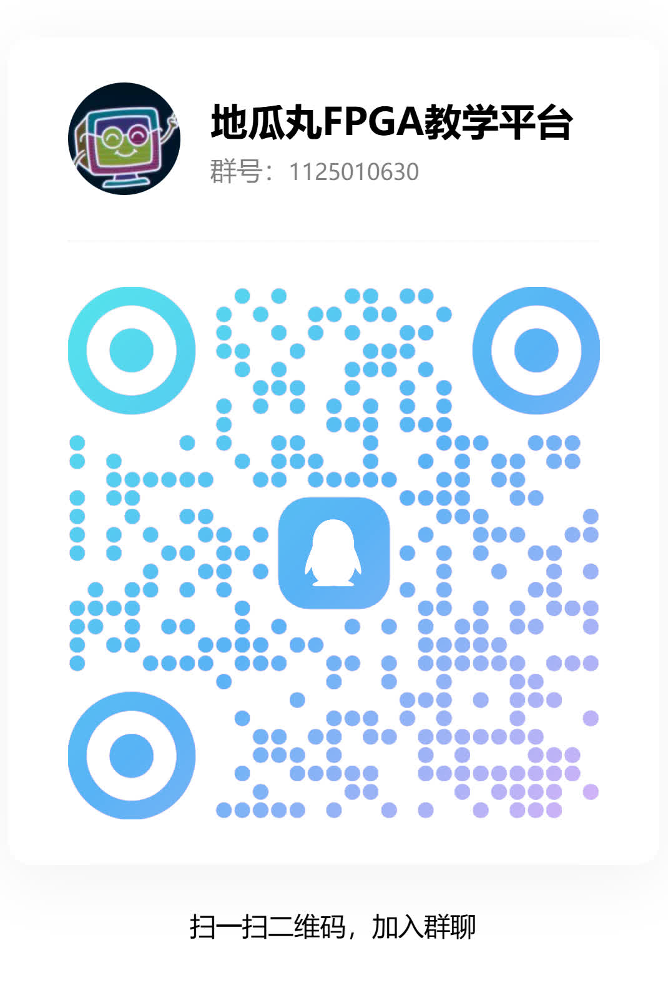

  
  <h1>地瓜丸的 FPGA 教学平台</h1>
  
<strong>别让“会写 Verilog”，永远停在“能编译”。</strong>

  
写代码、连引脚、看波形，让电路的变化有迹可循。

  

    
    
    
  

  

    
  

  
<a href="https://dgwfpga.cn/"><strong>进入平台 → dgwfpga.cn</strong></a> · <a href="https://dgwfpga.cn/practice/"><strong>直接开始练习</strong></a>

  
<a href="#先看看实际操作">功能演示</a> · <a href="docs/QUICKSTART.md">新手指南</a> · <a href="docs/FAQ.md">常见问题</a> · <a href="docs/COURSES.md">学习路线</a> · <a href="CHANGELOG.md">更新记录</a>

## 先看看实际操作

从一次连线、一条波形开始，看清平台具体能做什么。下面均为平台内实际操作录屏的短节选，保留操作和结果；板卡与屏幕为网页内可交互教具。

### 图形化接线，XDC 随之填写

选择代码端口，再选择板卡引脚，连接关系和约束文本会同步更新。时钟周期也能在面板里填写；接完线还可以检查或继续编辑文本。

### 把密集波形放大，观察真实边沿

先看整段仿真，再放大到关心的时间范围。支持窗口平移、适配、双游标与 ΔT、跳变导航和 CSV；普通信号过于密集时，可以请求局部精细波形。

<strong>继续看：LED 反馈、显示屏与板卡手册</strong>

### LED 与波形对应

走完练习中的接线、下载交互后，3D 板卡按仿真波形显示灯态。移动游标，观察同一时刻的信号与板卡反馈。

### 显示屏不只是一块黑色装饰

视频时序课程可观察彩条、移动方块与图片；点击屏幕可放大查看画面及几何信息。下图展示彩条与大屏窗口。

### 元件旁边就有手册

在练习页点击 3D 元件可打开对应手册，查看参数、引脚与使用要点；也可以在选关页搜索板卡手册。

操作节选取自 2026-10-25 版本，当前课程已扩充至 26 关。动图只展示各自覆盖的功能，完整交互请以在线平台为准。[查看功能说明 →](docs/FEATURES.md)

## 第一次来，从这里开始

1. 打开 [在线练习站](https://dgwfpga.cn/practice/)，首次建议进入“点亮两颗灯”。
2. 跟着第一关的引导完成代码、约束与运行，观察判题和波形。
3. 从第二关开始独立练习：先读目标，再修改代码，运行后检查结果。
4. 离开或换设备前，导出练习包，保存自己的代码与 XDC。

免费体验，无需先注册账号、下载本仓库或安装桌面 FPGA 开发工具。建议使用电脑，代码编辑与波形操作更方便。[完整新手指南 →](docs/QUICKSTART.md)

## 一条逐步深入的学习路线

| 学习阶段 | 你会动手练什么 | 希望看懂什么 |
| --- | --- | --- |
| 组合逻辑、时钟与计数 | LED、闪烁、消抖、流水灯 | 电平与引脚、计数器如何带来时间 |
| 时序与状态机 | 交通灯、PWM 呼吸灯 | 状态转移、占空比与输出变化 |
| 接口与显示 | UART、I²C、行场同步、彩条、方块与图片 | 数据如何按协议传输，像素如何组成画面 |
| 片上资源与综合 | 同步 FIFO、按键到 UART | 数据暂存、模块协作和时序配合 |
| 存储与网络协议 | ROM、RAM、SPI/SD、校验和、ARP、ICMP、UDP | 存取顺序、帧结构和收发行为 |
| 高速数据流 | Ready/Valid、Skid Buffer、异步 FIFO、CRC32 | 握手、反压、跨时钟与逐拍校验 |

课程为 **7 章、26 关**。上表按学习主题归纳，不等同于章节数量。[查看各关目标与推荐顺序 →](docs/COURSES.md)

## 错在哪里，要能找到证据

代码运行后，结合中文错误、判题检查项和波形定位问题。编辑器、控制台、资源与判题、波形区域都支持更宽敞的查看方式，让“看不清”不再成为分析时序的第一道门槛。

进阶内容包括两路仿真时钟下的异步 FIFO，以及 Ready/Valid、反压缓存、逐拍 CRC32。平台聚焦数字逻辑与行为验证；网页板卡交互不等同于对实体开发板烧录，也不替代真机时序验证。

## 学习进度怎么保存？

普通关卡的代码草稿、XDC 和进度保存在当前浏览器本地，不是账号云同步。第一关是教程关，每次进入会重新引导。

**要换电脑或长期保存，请先导出练习包。** 不要把清理浏览器数据当作日常排障的第一步。[查看保存与恢复说明 →](docs/FAQ.md)

## 一起学习，也欢迎指出问题

QQ群：**1125010630**

群内可以讨论关卡思路、波形和学习路线。二维码若失效，可搜索群号；具体入群状态以 QQ 提示为准。

发现问题：[提交问题反馈](https://github.com/bvsdehdshfbs300-debug/fpga-teaching-showcase/issues/new?template=bug_report.yml) · 有想法：[提出功能建议](https://github.com/bvsdehdshfbs300-debug/fpga-teaching-showcase/issues/new?template=feature_request.yml)

公开反馈请只附最小复现代码和必要截图，不要提交密码、Token、个人身份信息或不希望公开的作业。

## 持续更新

- **2026-11-04**：备案通过，正式域名恢复，迁至云服务器直连，启用 HTTPS 与自动续期。
- **3.0**：新增 Ready/Valid、Skid Buffer、双时钟异步 FIFO、流式 CRC32。
- **2.2**：平台脉搏、匿名学习动态、给地瓜丸充电。
- **波形台 2.0 / 2.1**：时间窗口、密集活动带、局部精细波形和测量工具。

[完整更新记录 →](CHANGELOG.md)

## 认识一下作者

这是地瓜丸持续维护的个人作品。目标很具体：让刚学 FPGA 的人，能把代码、波形和电路现象对起来。

[哔哩哔哩](https://space.bilibili.com/660494383) · [抖音公开课：什么是 FPGA？](https://v.douyin.com/U6EWdiSy7AA/) · [作者 GitHub](https://github.com/bvsdehdshfbs300-debug)

---

  
<strong>想象力遇上电路，从点亮第一颗 LED 开始。</strong>

  
<a href="https://dgwfpga.cn/">进入在线平台</a> · <a href="https://beian.miit.gov.cn/">苏ICP备2026085680号-1</a>

  © 地瓜丸 · FPGA 教学平台

## 关于本仓库

本仓库仅用于产品介绍、经审查的功能演示、使用指南与反馈收集，**不包含教学平台源码、判题逻辑、内部参考答案或服务端部署文件**。

图片、动图与品牌素材未经授权不得用于其他产品或商业宣传。仓库公开展示不代表主站开源；在线练习无需从本仓库下载任何实现文件。
