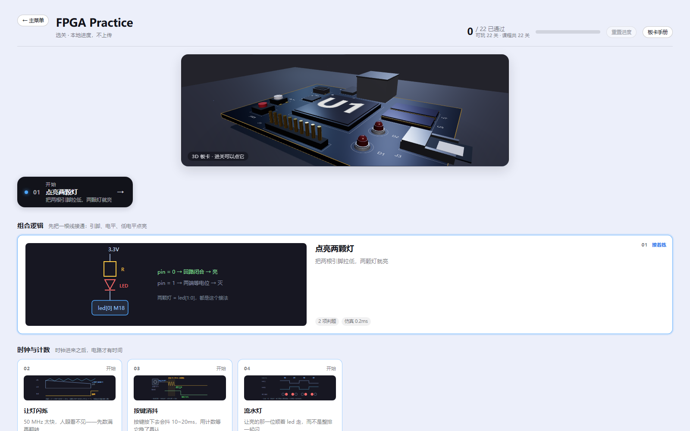
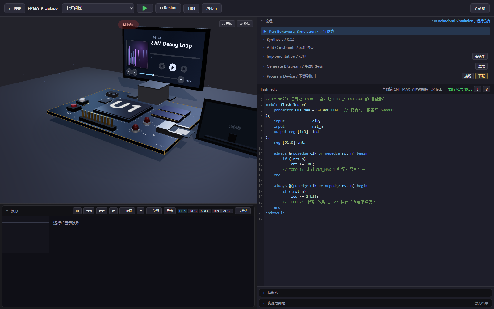

  
  <h1>地瓜丸的 FPGA 教学平台</h1>
  
<strong>别让“会写 Verilog”，永远停在“能编译”。</strong>

  
从第一颗 LED 到状态机、串口、显示与网络协议，把代码真正看成电路。

  

    
    
    
    
  

  
<a href="https://dgwfpga.cn"><strong>进入在线平台 → dgwfpga.cn</strong></a>

## 你缺的可能不是更多语法

你可能已经写过不少 Verilog，却仍然说不清：这段代码会变成怎样的电路，为什么波形总差一拍，程序跑通以后板卡究竟发生了什么。

语法背得再熟，如果代码、电路、时序和器件始终对不上，项目一复杂，学习就会卡在原地。真正拉开差距的，是能否看见现象、找到原因，再亲手改对它。

**这个平台不替你背答案。它帮你建立硬件直觉。**

## 从“写出来”走到“看明白”

- **从现象开始**：每一关先告诉你要让电路发生什么，而不是先塞一页术语。
- **让结果看得见**：代码、波形、流程和 3D 板卡放在同一个练习空间里，相互对应。
- **把错误讲人话**：不只告诉你“错了”，还会引导你定位原因和下一步修改。
- **没有板卡也能起步**：打开浏览器即可练习，把购买设备前最容易浪费的时间先变成有效训练。

## 一条能走完的学习路线

课程目前包含 **26 个可练习关卡**，从点亮 LED 开始，逐步进入：

`组合逻辑` · `时钟与计数` · `状态机` · `PWM` · `UART` · `I²C` · `显示时序` · `FIFO / ROM / RAM` · `SPI / SD` · `以太网与 UDP` · `高速数据流`

每一关都尽量回答三个问题：**你看到了什么？为什么会这样？下一步该改哪里？**

## 像工程工具，也像一位在旁边的老师

左侧观察 3D 板卡和波形，右侧完成代码与流程。学习不再是在教程、编辑器和结果窗口之间反复迷路，而是在一次练习里把它们连起来。

## 波形查看器 2.1 已上线

新的时间窗口支持放大、缩小、前后移动和一键适配。面对数十万次时钟跳变，全局视图会明确呈现高频活动；继续放大，则可以检查真实的纳秒级方波和边沿，不再把被压缩的数据误画成一条“没有变化”的直线。

普通计数器或状态信号过于密集时，可以在游标附近打开“精细窗口”。平台会重新执行同一段设计，只记录这一小段未经抽样的真实变化，再随时返回完整总览。游标、跳变导航和 CSV 导出也会跟随当前时间窗口，让波形不只是运行后的装饰，而是定位时序问题的工作台。

## 3.0 高速数据流已上线

新增四个连续关卡：Ready / Valid 握手、Skid Buffer、双时钟异步 FIFO 与流式 CRC32。学习者会从“哪一拍才算传输成功”开始，逐步处理下游停顿、急停缓存、125 MHz 与 100 MHz 两个时钟域之间的数据传递，以及每拍一个字节的 CRC32 校验。

这组课程聚焦数字逻辑层的流接口与跨时钟设计。异步 FIFO 使用两路真实仿真时钟、格雷码指针和两级同步器；每关均可运行代码、查看波形并接受逐时刻判题。

## 先看一节公开课

### 什么是 FPGA？从底层看看 FPGA 芯片内部

面向新手，从底层逻辑理解 FPGA，不把它讲成一块只会“运行代码”的黑盒子。

[在抖音观看教学视频 ↗](https://v.douyin.com/U6EWdiSy7AA/)

更多内容：[哔哩哔哩主页 ↗](https://space.bilibili.com/660494383) · [作者 GitHub ↗](https://github.com/bvsdehdshfbs300-debug)

## 如何进入平台

正式公开地址：[https://dgwfpga.cn](https://dgwfpga.cn)

打开浏览器即可开始练习，无需从 GitHub 下载源码，也无需在电脑上安装开发工具。

> 别等到真正做项目时，才发现自己会写语法，却还不会设计电路。现在就从第一颗 LED 开始，把代码、电路与现象真正连起来。

---

  
<strong>想象力遇上电路，从你的第一块 FPGA 开始。</strong>

  © 地瓜丸 · FPGA 教学平台

## 关于本仓库

本仓库仅用于平台介绍、界面展示与官方入口发布，**不包含教学平台源码、判题逻辑、参考答案或服务端实现**。页面图片与品牌素材未经授权不得用于其他产品或商业宣传。
