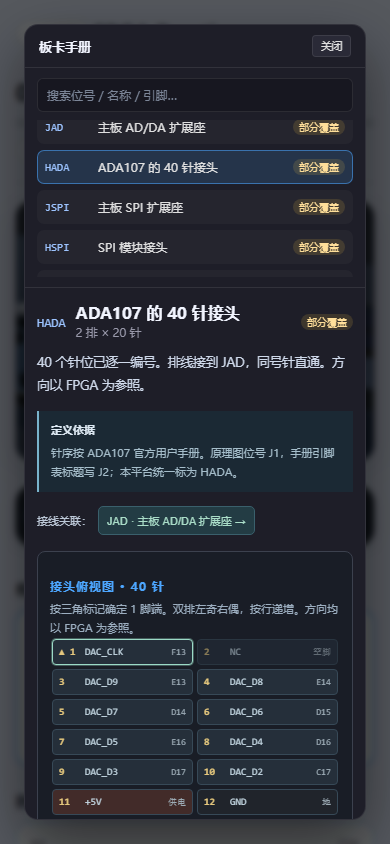

# 平台功能一览

[返回介绍页](../README.md) · [马上体验](https://dgwfpga.cn/practice/)

## 从题目到结果

| 功能 | 你可以做什么 |
| --- | --- |
| 课程地图 | 按 8 章查看 31 个练习，查看本地进度、继续上次普通关卡 |
| 入门教程 | 第一关逐步讲解代码、约束、运行、波形与板卡 |
| 引言与提示 | 阅读每关的背景、目标和机制图，按需要展开提示 |
| Verilog 编辑 | 语法高亮、修改草稿、定位报错、导入导出 |
| XDC | 手写约束、查引脚、图形化连接、同步检查文本 |
| 运行与判题 | 查看编译错误、检查项、通过情况与输出日志 |
| 中文反馈 | 从现象、原因和下一步修改方向分析问题 |
| 资源与器件布局 | 查看本次综合结果与布局走线的教学视图 |
| 大卡片 | 放大代码、控制台、资源判题和波形，减少拥挤 |

## 波形台

- 时间窗口缩放、前后移动、一键适配。
- 信号名与当前值对照，HEX、DEC、SDEC、BIN、ASCII 等显示方式。
- 双游标、时间差、跳变沿导航、时间标记。
- 信号隐藏、排序、虚拟总线与数值曲线。
- 周期时钟与高频活动总览，普通密集信号的局部精细窗口。
- 按当前窗口导出 CSV，进一步检查数据。

不同信号类型和窗口大小影响可用视图；有抽样的数据不伪装为逐边沿精度。

## 板卡与显示

在 3D 场景中查看部件、悬停信息与手册；练习中的接线和下载交互完成后，LED 按波形反馈。显示课程可把视频信号还原为彩条、方块与图片，支持大屏查看。

4.1 增加完整外设桌面：AD/DA、SPI、GPIO、PCIe 卡与主机测试座，提供全景、主板、AD/DA、SPI、GPIO、PCIe、仪器、接口八个视角。所有关卡都能查看这些设备。

- 五项独立课程：ADC 采样、DAC 波形、SPI 寄存器、GPIO 双向引脚、PCIe BAR 事务。
- 外设观察台跟随波形游标，显示本次运行的采样与协议信息；SPI、PCIe 提供事务解码。
- 9 个接口的逐针手册：查询针号、网络、FPGA 封装脚、供电、方向和关联接头。
- 三维接线连接到实际接点，接口点击与手册相互对应。
- 手册目录单列上下滚动，搜索保持可用；长正文独立滚动，手机改为上下排列。
- PCIe 课程覆盖单 DWORD Memory Read/Write、字节使能、完成响应与反压，范围为 BAR/TLP 事务接口。

这些是浏览器中的教学与观察能力，不应理解为对实体板卡的远程烧录或实机电气验证。

## 保存与交流

普通关卡保留本地草稿、约束与进度；练习包用于带走代码和约束。首页“平台脉搏”展示累计访问数、运行/通过与匿名动态，也可以“给地瓜丸充电”。

这份介绍只列已具备的能力。账号云同步、全国测速节点、完整三视图同步高亮等未完成功能不列为现有卖点。

## 站主管理与运行追踪

学员控制台和运行错误提示中提供运行编号，反馈时可用来查找具体请求。站主在独立登录的只读管理端查看运行总览，按时间、关卡、分类和编号检索；编译、约束和答案问题与平台故障分别统计。

管理端还能查看排队、服务、磁盘和每日数据库备份的完整性校验结果。该功能用于平台维护，不提供学员账号或跨设备云同步。

[查看实际界面与维护案例](https://bvsdehdshfbs300-debug.github.io/dgw-ai-archive/maintenance.html)
